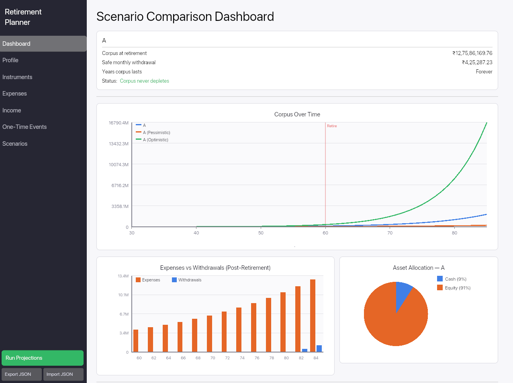
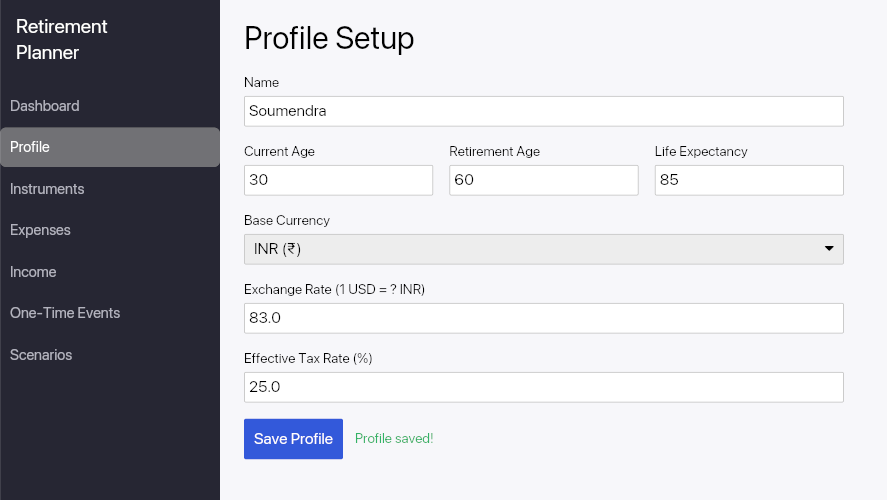
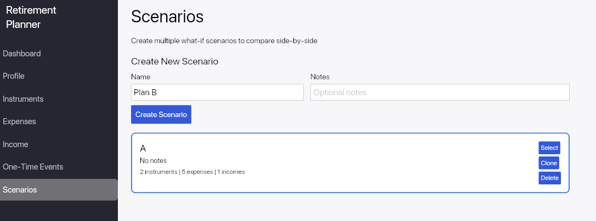
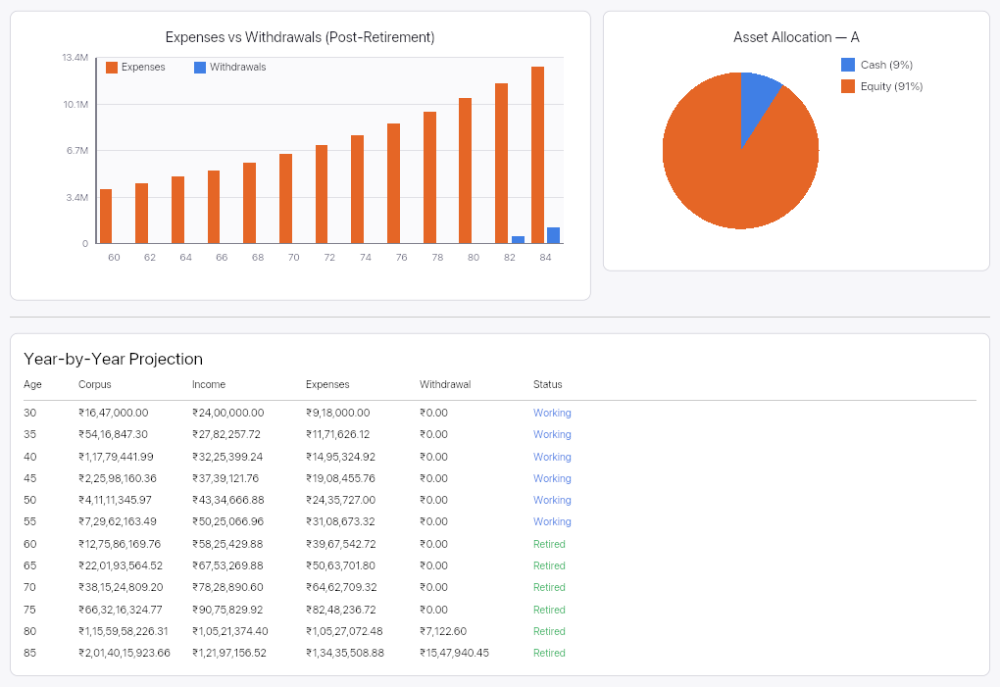

<div align="center">

# Retirement Planner

**A privacy-first, offline-only retirement planning desktop app built in Rust.**

[](https://github.com/soumendrak/retirement-planner/actions/workflows/ci.yml)
[](https://opensource.org/licenses/MIT)
[](https://www.rust-lang.org/)
[](https://iced.rs/)
[](https://github.com/soumendrak/retirement-planner)
[](https://github.com/soumendrak/retirement-planner)
[](https://github.com/soumendrak/retirement-planner)
[-003B57?logo=sqlite)](https://www.sqlite.org/)

Supports **USD** and **INR** currencies with multi-scenario comparison dashboards and rich visualizations.

</div>

---

## Screenshots

| Dashboard | Profile Setup |
|:-:|:-:|
|  |  |

| Scenario Comparison | Charts & Projections |
|:-:|:-:|
|  |  |

<details>
<summary><strong>App Layout</strong></summary>

```
┌──────────┬──────────────────────────────────────────┐
│ Sidebar  │  Content Area                            │
│          │                                          │
│ Dashboard│  Profile / Instruments / Expenses /       │
│ Profile  │  Income / Scenarios / Dashboard          │
│ Instru.  │                                          │
│ Expenses │  [Charts & Tables]                       │
│ Income   │                                          │
│ Scenarios│                                          │
│          │                                          │
│ [Run]    │                                          │
│ [Ex][Im] │                                          │
└──────────┴──────────────────────────────────────────┘
```

</details>

---

## Features

- **Fully offline** — no internet, no cloud, no telemetry
- **Privacy-first** — all data stored locally on your machine
- **Multi-currency** — USD (comma formatting) and INR (lakh/crore formatting)
- **Profile setup** — age, retirement age, life expectancy, flat tax rate
- **Investment instruments** — full CRUD with asset classes (Equity, Debt, Real Estate, Cash, Other)
- **Monthly expenses** — categorized with per-category or blanket inflation rates
- **Income sources** — salary, pension, rental with start/end years and annual growth
- **One-time events** — lump-sum inflows/outflows at specific ages
- **Variable return bands** — pessimistic / base / optimistic projections per instrument
- **Multiple scenarios** — create, clone, and compare what-if retirement plans
- **Rich dashboard** — side-by-side scenario comparison with:
  - Corpus over time line chart (multi-scenario overlay)
  - Expenses vs withdrawals bar chart
  - Asset allocation pie chart
  - Year-by-year projection table
- **JSON export/import** — save and load plans as portable JSON files
- **CSV export** — export projection data to CSV
- **Input validation** — validates imported data for correctness

---

## Tech Stack

| Layer | Choice | Crate |
|---|---|---|
| **Language** | Rust 1.75+ | — |
| **GUI** | iced 0.13 (pure Rust, wgpu-based) | [`iced`](https://crates.io/crates/iced) |
| **Storage** | SQLite (bundled, WAL mode) | [`rusqlite`](https://crates.io/crates/rusqlite) |
| **Charts** | iced canvas widget | Built-in |
| **Serialization** | JSON | [`serde`](https://crates.io/crates/serde) / [`serde_json`](https://crates.io/crates/serde_json) |
| **IDs** | UUID v4 | [`uuid`](https://crates.io/crates/uuid) |
| **Error handling** | Typed errors | [`thiserror`](https://crates.io/crates/thiserror) |

---

## Quick Start

### Prerequisites

- **Rust 1.75+** — install via [rustup](https://rustup.rs/)
- No other dependencies. SQLite is bundled.

### Build & Run

```bash
git clone https://github.com/soumendrak/retirement-planner.git
cd retirement-planner

# Release build (optimized, ~1 min first build for iced/wgpu)
cargo build --release

# Run the app
cargo run -p retirement-planner-ui --release
```

---

## Development

### Dev Build

```bash
# Debug build (faster compile, slower runtime)
cargo run -p retirement-planner-ui
```

### Testing

```bash
# Run all workspace tests
cargo test --workspace

# Run core logic tests only
cargo test -p retirement-planner-core

# Run with output
cargo test --workspace -- --nocapture
```

20 unit tests cover currency formatting, projection engine, SQLite CRUD, export/import, and one-time events.

### Linting & Formatting

```bash
# Format code
cargo fmt --all

# Check formatting (CI uses this)
cargo fmt --all -- --check

# Lint with clippy (warnings = errors in CI)
cargo clippy --all-targets --all-features -- -D warnings
```

### Benchmarks

```bash
# Run criterion benchmarks (projection engine)
cargo bench -p retirement-planner-core
```

### Release Build Profile

The release profile is tuned for small, fast binaries:

| Setting | Value |
|---|---|
| `opt-level` | 3 |
| `lto` | thin |
| `codegen-units` | 1 |
| `strip` | symbols |
| `panic` | abort |

---

## Project Structure

```
retirement-planner/
├── Cargo.toml                  # workspace root
├── crates/
│   ├── core/                   # domain logic — zero GUI deps
│   │   ├── src/
│   │   │   ├── lib.rs
│   │   │   ├── models/         # Profile, Instrument, Expense, Income, Scenario, OneTimeEvent
│   │   │   ├── engine.rs       # year-by-year projection engine + return bands
│   │   │   ├── currency.rs     # USD/INR formatting, cents/paise storage
│   │   │   ├── export.rs       # JSON + CSV export/import
│   │   │   └── storage.rs      # SQLite CRUD operations (WAL mode)
│   │   └── benches/            # criterion benchmarks
│   └── ui/                     # iced GUI shell
│       └── src/
│           ├── main.rs
│           ├── app.rs          # top-level app with sidebar navigation
│           ├── theme.rs        # color and spacing constants
│           ├── views/          # Profile, Instruments, Expenses, Income, Scenarios, Dashboard
│           ├── charts/         # Canvas-based charts (corpus line, withdrawal bar, allocation pie)
│           └── components/     # Reusable UI components (card, form_field, nav)
├── assets/                     # screenshots, icons, fonts
├── .github/workflows/ci.yml   # GitHub Actions CI
├── .rustfmt.toml               # formatting config
├── AGENTS.md                   # living project context document
└── README.md
```

### Architecture

```
┌──────────────────────────────────────────────────┐
│                   UI Crate (iced)                 │
│  ┌──────────┐  ┌──────────┐  ┌────────────────┐  │
│  │  Views   │  │  Charts  │  │  Components    │  │
│  └────┬─────┘  └────┬─────┘  └───────┬────────┘  │
│       │              │                │           │
│       └──────────────┼────────────────┘           │
│                      │                            │
├──────────────────────┼────────────────────────────┤
│                Core Crate (no GUI deps)           │
│  ┌──────────┐  ┌─────┴────┐  ┌────────────────┐  │
│  │  Models  │  │  Engine  │  │  Storage (SQL)  │  │
│  └──────────┘  └──────────┘  └────────────────┘  │
│  ┌──────────┐  ┌───────────┐                      │
│  │ Currency │  │  Export   │                      │
│  └──────────┘  └───────────┘                      │
└──────────────────────────────────────────────────┘
```

---

## How to Use

1. **Profile** — Enter your name, current age, retirement age, life expectancy, currency, and tax rate
2. **Instruments** — Add your investments (stocks, bonds, mutual funds) with expected returns and monthly contributions
3. **Expenses** — Add monthly expenses by category with optional per-category inflation rates
4. **Income** — Add income sources (salary, pension, rental) with start/end years
5. **Scenarios** — Create multiple what-if scenarios (e.g., "Conservative", "Aggressive")
6. **Run Projections** — Click the green button in the sidebar to run the simulation
7. **Dashboard** — View comparison cards, charts, and year-by-year projections

### JSON Export/Import

- **Export** — Click "Export JSON" → saves to `~/Documents/retirement_plan.json`
- **Import** — Click "Import JSON" → loads from `~/Documents/retirement_plan.json`

The JSON format is versioned for forward compatibility.

### CSV Export

Export year-by-year projections to `~/Documents/retirement_projections.csv` for use in spreadsheets.

---

## Design Decisions

| Decision | Rationale |
|---|---|
| `i64` cents/paise for all money | Avoids floating-point precision errors |
| Per-category inflation rates | Healthcare inflates differently than food |
| Flat effective tax rate | Simple — no complex tax bracket modeling |
| Fully offline | No API calls, no telemetry, no cloud |
| Pure Rust charts (iced canvas) | No C/C++ charting dependencies |
| SQLite with WAL mode | Fast concurrent reads, single-file database |
| Saturating arithmetic | Prevents overflow panics on extreme inputs |

---

## Contributing

Contributions are welcome! Here's how to get started:

1. **Fork** the repo and create a feature branch
2. **Write tests** for new functionality in the `core` crate
3. **Run the full check suite** before submitting:
   ```bash
   cargo fmt --all -- --check
   cargo clippy --all-targets --all-features -- -D warnings
   cargo test --workspace
   ```
4. **Open a PR** against `main`

### Guidelines

- Keep `core` crate free of GUI dependencies
- Store all monetary values as `i64` cents/paise
- Follow the existing code style (see `.rustfmt.toml`)
- Add tests for engine logic and storage operations

---

## Roadmap

- [ ] Onboarding wizard (first-run setup flow)
- [ ] Keyboard navigation (Tab, Enter, Escape)
- [ ] Undo/redo for form edits
- [ ] India-specific instruments (PPF, EPF, NPS modeling)
- [ ] Sequence-of-returns risk simulation
- [ ] Partial retirement (semi-retired phase modeling)
- [ ] PDF report generation

---

## Sponsor

If this project helps you, consider [sponsoring my work on GitHub](https://github.com/sponsors/soumendrak). Your support helps fund maintenance, documentation, and continued development.

## License

[MIT](https://opensource.org/licenses/MIT) — see `Cargo.toml` for details.
